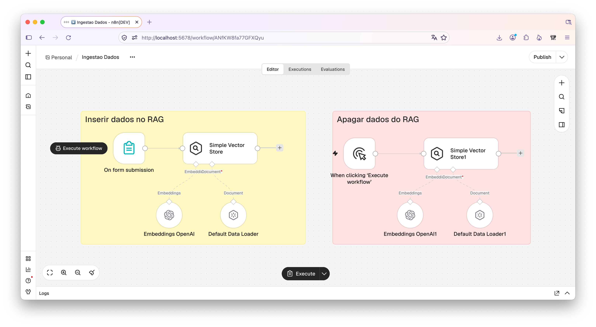
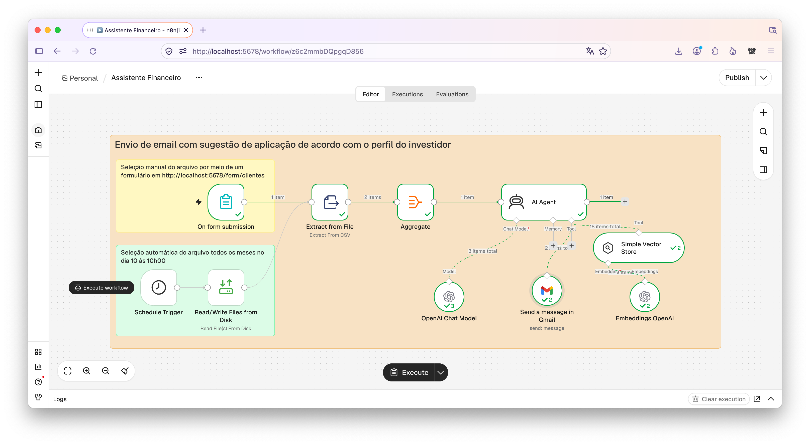
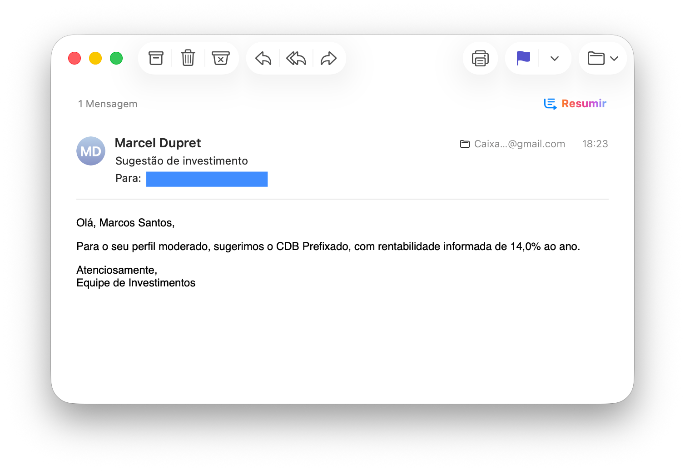
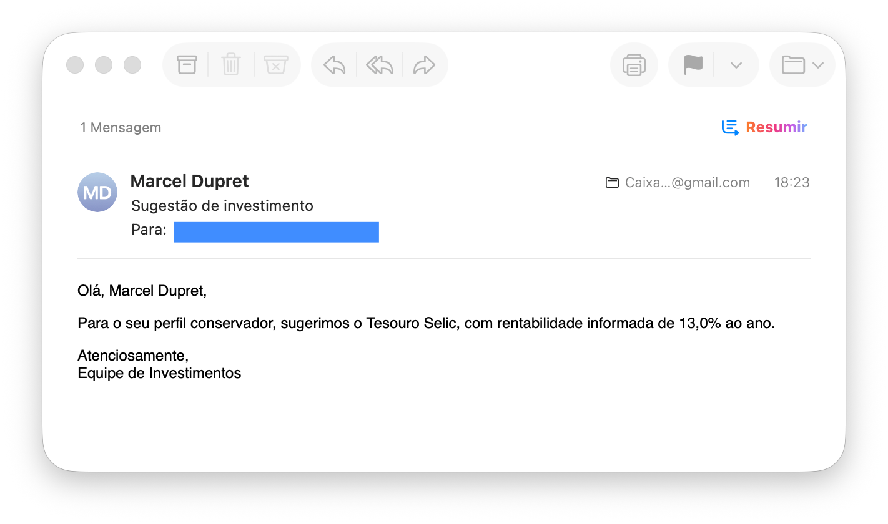

# 🏦 Assistente de Investimentos com RPA

Aplicação para automação de envio de email com sugestão de investimento na carteira da instituição conforme perfil do investidor apoiado pela análise de LLM.

Este projeto foi desenvolvido com o N8N tendo como motor do Agente de IA o modelo Lua 6 da OpenAICodex com o modelo. Faz parte do desafio de projeto do Bootcamp Santander/DIO 2026 - Automação com N8N.

## 🎯 O que o projeto faz

- Insere uma planilha com as aplicações disponíveis de acordo com perfil do investidor, contendo valor mínimo de aplicação e rentabilidade anual (RAG).
- Recebe uma planilha com dados dos investidores (nome, email, saldo, perfil) que pode ser indicada em um formulário, ou o sistema lê a planilha em cada dia 10 às 10h00.
- O assistente analisa a planilha dos investidores e cruza com o RAG para sugerir a melhor aplicação conforme o perfil e o saldo disponível.
- Após análise dos investidores escreve uma mensagem indicando a melhor aplicação para aquele mês.
- Envia automaticamente os emails para os investidores que possuam saldo compatível com as aplicações.


## 🖼️ Demonstração visual

### 🗂️ Workflow de ingestão de dados no RAG



### 📊 Workflow do assistente financeiro



### 📨 Exemplos de emails




## 🤖 Estrutura do Agente de IA

O nó de Agente de IA no N8N foi configurado com duas ferramentas, uma para enviar emails com o Gmail e outra para ler o RAG com as informações das aplicações disponíveis. Os prompts usados para o agente estão abaixo:

```text
PROMPT DO SISTEMA

Você é um assistente financeiro que enviará email para os clientes indicando uma sugestão de investimento de acordo com o perfil de investidor e o saldo atual. Seja objetivo e claro nas mensagens. Use tom cordial e vocabulário simples em português. Não invente informações. Você disponível a tool para envio de mensagens e também as informações sobre investimentos disponíveis conforme o perfil.
```
```text
PROMPT DO USUÁRIO

Segue a lista de clientes para envio de email com apenas uma sugestão de investimento, considerando o perfil, a maior rentabilidade e o saldo disponível.{{ $json.clientes.toJsonString() }}. Importante, nunca incluir o valor do saldo na mensagem, pois é uma informação sensível protegida pela LGPD. Se o saldo não for suficiente para nenhuma opção de investimento aderente ao perfil então não envie a mensagem para este investidor.Sugestão para formatação da mensagem em html: uma linha somente com saudação com o nome do cliente, um bloco separado com o corpo da mensagem indicando a melhor aplicação e para finalizar uma linha com Atenciosamente, e na linha seguinte Equipe de Investimentos.
```

## 🗂️ Estrutura do projeto

```text
.
├── planilhas/
│   ├── clientes.csv                  # Arquivo com os dados dos clientes
│   ├── perfil.csv                    # Arquivo com as aplicações 
├── workflows/
│   ├── Assistente Financeiro.json    # Rotas FastAPI, autenticação e páginas
│   ├── Ingestao Dados.json           # Modelos SQLAlchemy
└── imgs/                             # Imagens usadas nesta documentação

```

## 💡 Dicas

- O N8N pode ser usado em nuvem (n8n.io) ou instalado localmente. Em nuvem pode ser usado gratuitamente por 14 dias, já instalado localmente pode ser usado livremente sem custos.
- Os workflows podem ser carregados diretamente no N8N e utilizados sem precisar de grandes ajustes, apenas devem ser criadas as credenciais para a OpenAI (poder usar a API) e para o Google Gmail.
- Para poder ler o arquivo de clientes localmente deve ser criado um diretório em USUARIO/.n8n-files e copiar o arquivo neste lugar, se não o N8N não consegue realizar a leitura.
- Antes do primeiro uso do Workflow do Assistente Financeiro deve-se executar o workflow de Ingestão de Dados, pois assim a planilha de perfil é usada para criar um RAG (Retrieval Augmented Generation ou Generação Aumentada por Recuperação) que o modelo de IA irá consumir para usar como conhecimento. Este workflow somente será usado novamente caso a planilha de perfil seja alterada. Neste caso deve-se usar a seção para apagar os dados e ler novamente os dados da planilha.


